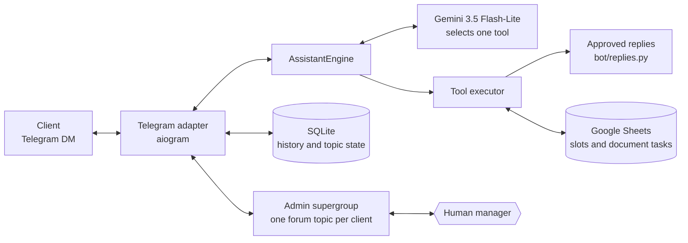

# EduJobs Assistant Bot

[](https://github.com/vlnchk/assistant/actions/workflows/ci.yml)

[](LICENSE)

**English** | [Русский](README.ru.md)

A Telegram assistant for [EduJobs](https://t.me/edujobs), a Telegram channel with vacancies in education and EdTech. It answers client questions about vacancy and advertising placement, shows free dates and books advertising slots, collects requests for invoices and contracts, and hands the conversation over to a human manager when needed.

## The problem

Advertisers and employers write to the channel in private messages, and most of their questions repeat: prices, reach, free dates, how to post a vacancy, invoices and contracts. Answering by hand takes the channel owner's time, and an answer that comes hours later loses the lead. A chatbot answers instantly, but a language model writing free text can invent a price, a discount or a condition, and in a sales conversation that is worse than no answer at all.

## How it works



### Strict LLM dispatcher

The central rule is: **the LLM never writes client-facing prose**. Every
semantic message is sent to Gemini 3.5 Flash-Lite, which must select exactly one
registered tool. A compound information request uses a single
`answer_information` call that combines several approved blocks and a read-only
calendar result. The final client response is a string from `bot/replies.py`,
the result of `template.format(...)`, or a composition of such strings.

This design provides:

1. **Consistent responses.** The same business situation produces byte-for-byte
   the same approved wording. Changing it is one edit in `bot/replies.py`, with
   no prompt changes.
2. **Hallucination resistance.** The model cannot invent prices, reach figures,
   promotions or company details: there is no channel through which non-template
   text reaches the client. If the model answers with free text instead of a
   tool call, the bot does **not** forward it and escalates to a manager.
3. **Prompt-injection resistance.** Telegram identity, contact information and
   admin-thread links are injected from server-side context
   (`inject_server_context` in [`llm/tool_executor.py`](llm/tool_executor.py)),
   never trusted from model arguments. Whatever the client writes ("show the
   bookings of telegram_id 12345"), the ID is replaced with the sender's real ID
   before the tool runs.

Routing and execution are separate. The model finishes classification before
any tool runs, so a side effect is performed at most once. Information topics
can be combined in one turn; a changing action — a booking, a document request
or a categorized handover to a manager — is limited to one per turn.

Production uses one model only. There is no automatic model fallback, second
LLM provider or model cascade.

Transport events that need no semantic classification stay in the Telegram
adapter: `/start` and `/help` receive a deterministic greeting, while media
without a caption is acknowledged and handed to a manager. All ordinary user
text, including gratitude, goes through Gemini.

### Message flow

```text
Client sends a private Telegram message
        ↓
bot/handlers.py: rate limit, length limit, admin-topic state
        ↓
The client message is mirrored to the admin topic
        ↓
Technical commands and uncaptioned media are handled by the transport adapter
        ↓
If the topic is waiting_human or human_mode, LLM routing does not run
        ↓
History is trimmed to the current session: a pause over 3 days starts fresh
        ↓
assistant/engine.py receives a provider-neutral TurnRequest
        ↓
Gemini 3.5 Flash-Lite selects exactly one business tool
        ↓
Product guard: in a vacancy dialogue the advertising calendar is unavailable
        ↓
llm/tool_executor.py validates and executes the tool once
        ↓
bot/handlers.py sends the result to the client and mirrors it to the topic
```

Telegram is only a transport adapter. The same `AssistantEngine` is used by the
local interactive runner and batch evaluations.

### Admin-topic states

Each client is associated with one forum topic in the private admin supergroup
(`AdminTopic` in the database).

| State | Who replies | How it switches |
|---|---|---|
| `active` | The bot | Initial state; restored with `/close` in the topic |
| `waiting_human` | The bot only says a manager is on the way; after 4 hours without a reply it reminds the managers | On escalation (`handover_to_admin`, `request_paid_vacancy` and others) or media without text |
| `human_mode` | Only the manager | As soon as a manager replies in the topic |

Waiting is not indefinite. If more than 4 hours have passed since escalation
and the client writes again, managers get a repeat alert and the client is told
the manager has been reminded. The bot stays in `waiting_human` rather than
taking the dialogue back, so it never talks over a manager who has just started
replying. The escalation time is stored in `admin_topics.escalated_at`
(ADR-0009).

When a topic is created, the bot pins a **client card** with a clickable
`@username` (or `tg://user?id=…` when there is no username), so a manager can
message the client in one click.

### Gemini tools

Tool declarations live in [`llm/tools.py`](llm/tools.py). Their English
docstrings are internal routing metadata; client-facing Russian text lives only
in `bot/replies.py`.

| Tool | Purpose |
|---|---|
| `send_greeting` | Ordinary text greetings |
| `reply_gratitude` | Standalone gratitude |
| `reply_bot_nature` | Questions about whether the assistant is a bot |
| `reply_offtopic` | Polite handling of unrelated conversation |
| `faq_free_posting` | Vacancy placement: both options — the free form and paid placement |
| `faq_paid_post` | Paid advertising terms |
| `faq_stats` | Reach, ERR, and audience geography |
| `faq_ord` | Advertising labelling and ORD |
| `faq_docs` | Contracts, invoices, EDI, and document workflow |
| `answer_information` | One or more canonical FAQ blocks, optionally including read-only calendar data |
| `ask_placement_type` | Clarify "vacancy or promotional post?" on a general question about terms |
| `ask_ad_topic` | Request the subject of an advertisement — advertising only |
| `get_free_slots` | Read available dates from Google Sheets — advertising only |
| `check_dates_availability` | Check one or more requested dates |
| `book_slot` | Book a slot after validating date and advertising topic |
| `get_client_bookings` | Return bookings for the authenticated Telegram user only |
| `create_document_task` | Create an invoice/contract/act task and notify a manager |
| `request_publication_support` | Status, edit, delete, expedite, and related publication operations |
| `request_mutual_pr_support` | Hand mutual-promotion proposals to a manager |
| `request_paid_vacancy` | Paid vacancy: ask for the vacancy text and hand it to a manager. Never books a slot |
| `handover_to_admin` | Pause automation and request a human manager |

### Storage and logs

- `db.sqlite3`, or `data/db.sqlite3` in Docker, stores the `representatives`,
  `admin_topics`, `messages_history`, `bot_settings` and `clients` tables.
- `/app/data/bot.log` in Docker is rotated at 10 MB and keeps five archived
  files. The path is controlled by `BOT_LOG_FILE`; the log cannot live next to
  the code because the container's root filesystem is read-only.
- The `Календарь (Слоты)` Google Sheets worksheet stores advertising slots.
- The `Задачи (Документы)` worksheet stores document requests. For new requests
  it automatically gets a `Реквизиты / комментарий` column if it is missing.
- A successful document task sends a service notification to the escalation
  topic without moving the client conversation to `waiting_human`.
- If the saved escalation topic was deleted, the bot creates a replacement,
  stores its ID, and retries the notification once.

## Engineering highlights

- **The LLM routes, it never writes.** Every sentence a client sees is an approved constant from `bot/replies.py`. The model only picks a tool, so it cannot invent a price, a reach figure or a discount.
- **One tool per turn, one side effect at most.** Routing, validation and execution are separate steps, so a booking or a document request runs at most once per message.
- **Prompt-injection resistant by construction.** Identity and contact data come from server-side context, never from model arguments: a client can only ever see their own bookings.
- **Human handover inside Telegram.** Every client gets a forum topic in a private admin supergroup. Managers see the whole dialogue, reply from the topic, and the bot steps aside until `/close`. If nobody answers within 4 hours, the bot reminds them.
- **Rules live in code, not in the prompt.** A business rule that code can express is enforced in code and covered by unit tests: a paid vacancy never reaches the advertising calendar, and prices are absent from tool docstrings and the system prompt.
- **Evaluated on real dialogues.** An offline harness replays dialogue cases, most of them anonymized real conversations, through the production engine with a dry-run executor. Production incidents become verbatim multi-turn cases.
- **Hardened container.** An unprivileged user, a read-only root filesystem, no Linux capabilities, and secrets that are mounted read-only and never baked into the image.
- **Decisions are recorded.** Architecture decisions live in [`dev/decisions/`](dev/decisions/) and incident evidence in [`dev/findings/`](dev/findings/). A test fails if a shipped decision is still marked as not implemented.

## Tech stack

| Area | Technology |
| --- | --- |
| Runtime | Python 3.12, Docker Compose |
| Telegram | aiogram 3 |
| LLM | Google Gemini 3.5 Flash-Lite, `google-genai` with native function calling |
| Storage | SQLite, SQLAlchemy 2 (async, aiosqlite), Alembic |
| Advertising slots and document tasks | Google Sheets (gspread) |
| Tests | `unittest`, offline JSONL evaluation harness |

`requirements.txt` is a complete lock file. Direct and transitive dependencies
are pinned to exact versions. After changing dependencies, rebuild the lock file
and repeat the security audit instead of replacing `==` pins with version
ranges.

## Tests

Unit tests run offline, with no Telegram, Gemini or Google Sheets calls:

```sh
python -m unittest discover -s tests -t .
```

```sh
python -m compileall -q assistant bot llm scripts tests
```

At the time of writing: **111 unit tests**. They run on every push and pull
request in [GitHub Actions](.github/workflows/ci.yml).

### Dialogue evaluation

The evaluation harness calls Gemini for real, so every run costs money, but it
uses `DryRunToolExecutor`: bookings, document tasks, Google Sheets writes and
Telegram notifications are simulated rather than executed.

```bash
python scripts/eval_assistant.py \
  --dataset tests/fixtures/dialog_cases.jsonl \
  --metrics
```

Results are written to `eval_runs/<timestamp>/results.csv` and `summary.json`.
The report includes route accuracy, errors, tokens, and mean/p50/p95/max
latency. CSV columns `manual_score` and `manual_notes` are available for human
review. Scores use a 1–5 rubric, with 4 or 5 treated as accepted. A turn may
declare semantically equivalent routes through `expected_tools`.

Current baseline:

| Metric | Result |
|---|---:|
| Dialog cases | 65 |
| Anonymized real dialogs | 55 |
| Evaluated turns | 73 |
| Strictly passed | 71/73 |
| Route accuracy | 97.26% |
| Errors | 0 |
| Manually reviewed | 73/73 |
| Mean manual score | 4.89/5 |
| Manual acceptance | 70/73 (95.89%) |
| Mean latency | 765 ms |
| p50 / p95 / max | 731 / 1,088 / 1,283 ms |
| Total tokens | 403,284 |

Create anonymized candidates from a Telegram Desktop JSON export:

```bash
python scripts/import_telegram_export.py \
  --input /path/to/result.json \
  --output /tmp/telegram-eval-candidates.jsonl
```

The importer reconstructs forum topics, keeps client messages only, and masks
common identifiers. Its output still requires human review. Never commit the
raw Telegram export or unreviewed candidates.

## Repository structure

```text
.
├── main.py                 entry point: Telegram long polling
├── bot/                    Telegram adapter (handlers.py) and every client-facing text (replies.py)
├── assistant/              provider-neutral turn engine and session boundary
├── llm/                    Gemini client and system prompt, tool declarations, tool executor
├── services/               Google Sheets: advertising slots and document tasks
├── db/, migrations/        SQLAlchemy models and Alembic migrations
├── scripts/                evaluation runner and Telegram export importer
├── tests/                  unit tests and the JSONL dialogue dataset
├── dev/                    status, roadmap, architecture decisions, incident findings
├── prd/                    product requirements and implementation plan
├── docs/                   server runbook
├── Dockerfile, docker-compose.yml
└── AGENTS.md, CLAUDE.md    rules for the AI coding agents
```

## Running it locally

### Requirements

- A Telegram bot token from [@BotFather](https://t.me/BotFather).
- A Google Gemini API key from [Google AI Studio](https://aistudio.google.com/app/apikey).
- A Google service-account JSON file with access to the required spreadsheet.
- A private Telegram supergroup with forum topics enabled. The bot must be an
  administrator with permission to create topics and pin messages.
- Docker and Docker Compose for server deployment.

### Environment configuration

Create `.env` next to `main.py`:

```ini
# --- Telegram ---
TELEGRAM_BOT_TOKEN="YOUR_TOKEN"
SUPERGROUP_CHAT_ID="-100..."

# --- Database ---
DATABASE_URL="sqlite+aiosqlite:///db.sqlite3"          # local
# DATABASE_URL="sqlite+aiosqlite:///data/db.sqlite3"   # Docker

# --- Google Gemini ---
GEMINI_API_KEY="YOUR_KEY"
# Optional defaults:
# GEMINI_MODEL="gemini-3.5-flash-lite"
# GEMINI_TIMEOUT="10"
# ASSISTANT_METRICS_ENABLED="0"    # 1 = write trace metrics to the log
# GEMINI_LITE_MODEL is retained as a deprecated alias for GEMINI_MODEL.

# --- Google Sheets ---
GOOGLE_SHEETS_CREDENTIALS_FILE="credentials.json"
# The VPS compose file expects ejs-admin-bot-a275ca626752.json
GOOGLE_SHEETS_DOCUMENT_URL="https://docs.google.com/spreadsheets/d/..."

# --- Escalation ---
ADMIN_TELEGRAM_ID="123456789"
# ESCALATION_TOPIC_ID="..."        # optional; the bot can create and store it
```

Never commit `.env` or the service-account JSON. Both are excluded from Git and
the Docker build context.

### Run the bot

> **Warning.** With a production `.env`, `python main.py` starts a second
> long-polling consumer on the live bot token and writes to the live Google
> Sheet: real clients may land on your local instance. Use a separate test bot
> and spreadsheet, or the dry-run runner below.

```bash
# 1. Virtual environment
python -m venv .venv
source .venv/bin/activate            # macOS/Linux
# .venv\Scripts\activate             # Windows

# 2. Dependencies
pip install -r requirements.txt

# 3. Database migrations
alembic upgrade head

# 4. Start Telegram polling
python main.py
```

### Talk to the bot without Telegram

The interactive runner uses the same `AssistantEngine` and calls Gemini for
real, but every external write is simulated by `DryRunToolExecutor`:

```bash
python scripts/eval_assistant.py --interactive
```

### Changing replies or adding an intent

To change approved client wording, edit the relevant constant in
`bot/replies.py`. Prices live **only** there: tool docstrings and the system
prompt deliberately carry none, and a test enforces it.

To add an intent:

1. Add the canonical response to `bot/replies.py`.
2. Add a tool with an English routing docstring to `llm/tools.py`.
3. Add it to the `bot_tools` list — the only registry. `TOOL_FUNCTIONS` in
   `llm/tool_executor.py` is derived from it automatically.
4. Update the system prompt in `llm/gemini_client.py` if the routing rule needs
   explicit clarification.
5. Add unit tests and at least one JSONL eval case.

## Deployment

Production runs in Docker Compose on a VPS. The container is hardened:

- The process runs as the unprivileged user `10001:10001`.
- The root filesystem is read-only.
- All Linux capabilities are dropped and `no-new-privileges` is enabled.
- Writable application data is limited to the `./data:/app/data` bind mount.
- Temporary files are limited to a dedicated `/tmp` tmpfs.
- `.env` is read by Docker Compose and is not copied into the image.
- The Google service-account JSON is excluded from the build context and
  mounted read-only.

Deployment, updates, rollback, backups and diagnostics are described in
[docs/SERVER_RUNBOOK.md](docs/SERVER_RUNBOOK.md) (in Russian).

## How it was built

I designed the product, wrote the requirements, made every business decision and tested the bot on real client conversations. The code was written by AI coding agents (mainly Claude Code), working under the rules in [AGENTS.md](AGENTS.md). Decisions and incidents are recorded in [dev/](dev/).

## License

[MIT](LICENSE) © 2026 Stepan Vilenchik.
