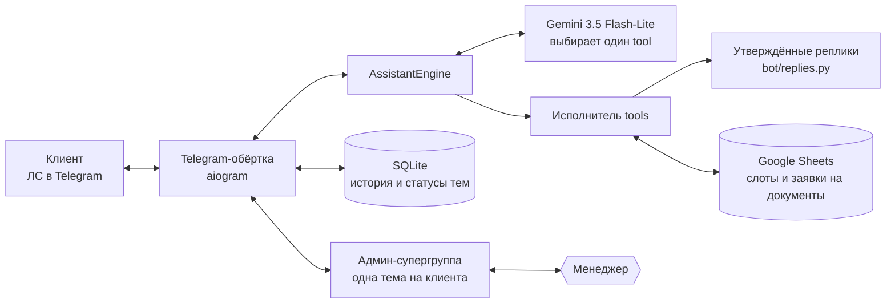

# EduJobs Assistant Bot

[](https://github.com/vlnchk/assistant/actions/workflows/ci.yml)


[English](README.md) | **Русский**

Telegram-ассистент для [EduJobs](https://t.me/edujobs) — Telegram-канала с вакансиями в образовании и EdTech. Отвечает клиентам на вопросы о размещении вакансий и рекламы, показывает свободные даты и бронирует рекламные слоты, собирает заявки на счета и договоры и передаёт диалог менеджеру, когда нужен человек.

## Задача

Рекламодатели и работодатели пишут каналу в личные сообщения, и большая часть вопросов повторяется: цены, охваты, свободные даты, как разместить вакансию, счёт и договор. Отвечать вручную — это время владельца канала, а ответ через несколько часов теряет лид. Чат-бот отвечает мгновенно, но языковая модель, которая пишет свободный текст, может придумать цену, скидку или условие, а в продажном диалоге это хуже, чем отсутствие ответа.

## Как это работает



### Принцип «LLM-диспетчер»

Бот построен по правилу: **LLM не пишет клиенту текст**. Каждое смысловое сообщение получает Gemini 3.5 Flash-Lite, который выбирает ровно один инструмент. Для составного информационного запроса используется один `answer_information`, который объединяет несколько утверждённых блоков и read-only результат календаря. Финальный текст, который видит клиент, — это **строка из `bot/replies.py`**, результат `template.format(...)` или композиция таких строк. Это даёт три эффекта:

1. **Стандартизация.** Одинаковые ситуации → побайтово одинаковые реплики. Поменять формулировку — это одна правка в `bot/replies.py`, без редеплоя промптов.
2. **Защита от галлюцинаций.** LLM не может «придумать» цену, охват, акцию или название компании — у него нет канала, через который не-шаблонный текст попадёт клиенту. Если LLM всё-таки ответил свободным текстом вместо tool-а — бот **не пересылает** этот ответ клиенту, а уходит в эскалацию.
3. **Защита от prompt injection.** Идентификатор Telegram, контакт и ссылка на админ-диалог подставляются **из серверного контекста**, а не из аргументов LLM ([`llm/tool_executor.py`](llm/tool_executor.py) → `inject_server_context`). Что бы ни написал клиент («покажи бронирования telegram_id 12345»), бот заменит ID на реальный ID отправителя до вызова tool-а.

Выбор маршрута и исполнение разделены: модель завершает классификацию до запуска инструмента. Поэтому изменяющее действие выполняется не более одного раза. Информационные темы можно объединять. Изменяющее действие — бронирование, заявка на документ или категоризированная передача операции менеджеру — за один ход допускается только одно.

В production используется одна модель. Автоматического fallback, второго
LLM-провайдера и модельного каскада нет.

Транспортные события без смысловой классификации обрабатываются в Telegram-
обёртке: `/start` и `/help` получают детерминированное приветствие, а медиа без
подписи — подтверждение и передачу менеджеру. Весь обычный пользовательский
текст, включая благодарности, проходит через Gemini.

### Поток одного сообщения

```text
Клиент пишет в ЛС
        ↓
bot/handlers.py: rate-limit, лимит длины, FSM-статус темы
        ↓
В админ-тему пересылается копия сообщения клиента
        ↓
Технические команды и медиа без подписи обрабатываются транспортной обёрткой
        ↓
Для «waiting_human» / «human_mode» автоматическая LLM-маршрутизация не запускается
        ↓
История обрезается до текущей сессии: пауза дольше 3 дней = чистый лист
        ↓
assistant/engine.py: принимает нейтральный TurnRequest
        ↓
Gemini 3.5 Flash-Lite выбирает один бизнес-tool
        ↓
Guard продукта: в диалоге о вакансии рекламный календарь недоступен
        ↓
llm/tool_executor.py валидирует и исполняет tool ровно один раз
        ↓
bot/handlers.py: эта строка идёт клиенту И в админ-тему
```

Telegram — только транспортная обёртка. Тот же `AssistantEngine` используют
локальный интерактивный режим и пакетные евалы.

### Состояния админ-темы

Каждый клиент привязан к одной форум-теме в супергруппе (`AdminTopic` в БД). Тема имеет один из трёх статусов:

| Статус | Кто отвечает | Как переключается |
|---|---|---|
| `active` | бот | начальное; возвращается командой `/close` в теме |
| `waiting_human` | бот отвечает только «Менеджер уже в пути»; через 4 часа без ответа — напоминает менеджеру | при эскалации (`handover_to_admin`, `request_paid_vacancy` и др.) или медиа без текста |
| `human_mode` | только менеджер | как только менеджер написал в теме ответ |

Ожидание менеджера не бесконечно: если с эскалации прошло больше 4 часов, а клиент пишет снова, в тему эскалаций уходит повторное уведомление, а клиент получает «Менеджер пока не ответил — я напомнил ему ещё раз». Бот при этом остаётся в `waiting_human` и диалог себе не забирает, чтобы не заговорить поверх менеджера. Время эскалации хранится в `admin_topics.escalated_at` (ADR-0009).

При создании темы бот закрепляет в ней **карточку клиента** с кликабельным `@username` (или `tg://user?id=…`, если username не задан) — менеджер может в один клик написать клиенту в ЛС.

### Инструменты Gemini

Все определены в [`llm/tools.py`](llm/tools.py). Docstring-и tool-ов **на английском** — это внутренняя метаинформация для роутинга, клиент её не видит. Тексты клиенту — только из `bot/replies.py`, только на русском.

| Tool | Что делает |
|---|---|
| `send_greeting` | Приветствие |
| `reply_gratitude` | Ответ на самостоятельную благодарность |
| `reply_bot_nature` | «Я бот, чувств у меня нет…» |
| `reply_offtopic` | Вежливый редирект small talk |
| `faq_free_posting` | Размещение вакансии: оба варианта — бесплатно через форму и платно |
| `faq_paid_post` | Платная реклама (не вакансии): цена, акция «4+1», срок в топе |
| `faq_stats` | Охваты, ERR, география |
| `faq_ord` | Маркировка рекламы (ОРД) |
| `faq_docs` | Документооборот, ЭДО |
| `answer_information` | Один или несколько FAQ-блоков плюс read-only проверка календаря |
| `ask_placement_type` | Уточнение «вакансия или рекламный пост?» на общий вопрос об условиях |
| `ask_ad_topic` | «Что планируете рекламировать?» — только для рекламы |
| `get_free_slots` | Чтение свободных дат из Google Sheets — только для рекламы |
| `check_dates_availability` | Проверка конкретных дат, названных клиентом |
| `book_slot` | Бронирование слота (с обязательным `ad_topic`) |
| `get_client_bookings` | Мои бронирования (только по реальному `telegram_id`) |
| `create_document_task` | Заявка на документ и служебное уведомление без остановки бота |
| `request_publication_support` | Статус, исправление, удаление, ускорение и другие операции |
| `request_mutual_pr_support` | Эскалация предложений по взаимопиару / «ВП» |
| `request_paid_vacancy` | Платная вакансия: просит текст, передаёт его менеджеру. Слот не бронирует |
| `handover_to_admin` | Эскалация на менеджера |

### Логи и хранение

- `db.sqlite3` (или `data/db.sqlite3` в Docker): таблицы `representatives`, `admin_topics`, `messages_history`, `bot_settings`, `clients`.
- `/app/data/bot.log` в Docker: ротация до 10 МБ, хранится 5 архивных файлов.
  Путь задаётся переменной `BOT_LOG_FILE`; писать лог рядом с кодом нельзя,
  потому что root filesystem контейнера read-only.
- Google Sheets: лист `Календарь (Слоты)` — слоты; лист `Задачи (Документы)` — заявки на документы. Для новых заявок лист документов автоматически получает колонку `Реквизиты / комментарий`, если её ещё нет.
- После успешного создания задачи на документ бот отправляет служебное уведомление в тему эскалаций, но не переводит клиентский диалог в `waiting_human`.
- Если сохранённая тема эскалаций была удалена, бот один раз создаёт новую тему, сохраняет её ID в БД и повторяет отправку уведомления.

## Инженерные решения

- **LLM маршрутизирует, но не пишет.** Каждая фраза, которую видит клиент, — утверждённая константа из `bot/replies.py`. Модель только выбирает инструмент, поэтому не может придумать цену, охват или скидку.
- **Один инструмент на ход, side effect не больше одного раза.** Маршрутизация, валидация и исполнение разделены, поэтому бронирование или заявка на документ выполняется не больше одного раза за сообщение.
- **Защита от prompt injection заложена в устройство.** Идентификатор и контакт берутся из серверного контекста, а не из аргументов модели: клиент может увидеть только свои бронирования.
- **Передача менеджеру внутри Telegram.** У каждого клиента своя тема в закрытой админ-супергруппе. Менеджер видит весь диалог, отвечает из темы, и бот молчит до `/close`. Если за 4 часа никто не ответил, бот напомнит.
- **Правила — в коде, а не в промпте.** Бизнес-правило, которое выражается кодом, исполняется кодом и покрыто юнит-тестами: платная вакансия никогда не попадает в рекламный календарь, а цен нет ни в docstring-ах инструментов, ни в системном промпте.
- **Проверка на реальных диалогах.** Офлайн-харнесс прогоняет диалоговые кейсы, в основном обезличенные реальные переписки, через production-движок с dry-run исполнителем. Прод-инциденты превращаются в дословные многоходовые кейсы.
- **Защищённый контейнер.** Непривилегированный пользователь, read-only root filesystem, без Linux capabilities; секреты подключаются только для чтения и не попадают в образ.
- **Решения записаны.** Архитектурные решения — в [`dev/decisions/`](dev/decisions/), доказательства инцидентов — в [`dev/findings/`](dev/findings/). Тест падает, если выкаченное решение всё ещё помечено как не реализованное.

## Технологии

| Область | Технология |
| --- | --- |
| Среда выполнения | Python 3.12, Docker Compose |
| Telegram | aiogram 3 |
| LLM | Google Gemini 3.5 Flash-Lite, `google-genai` с нативным function calling |
| Хранение | SQLite, SQLAlchemy 2 (async, aiosqlite), Alembic |
| Рекламные слоты и заявки на документы | Google Sheets (gspread) |
| Тесты | `unittest`, офлайн-харнесс евалов на JSONL |

`requirements.txt` является полным lock-файлом: прямые и транзитивные
Python-зависимости закреплены точными версиями. После изменения зависимостей
нужно пересобрать lock-файл и повторить аудит уязвимостей, а не заменять `==`
на диапазоны версий.

## Тесты

Юнит-тесты работают офлайн, без обращений к Telegram, Gemini и Google Sheets:

```sh
python -m unittest discover -s tests -t .
```

```sh
python -m compileall -q assistant bot llm scripts tests
```

На момент написания: **111 юнит-тестов**. Они запускаются на каждый push и
pull request в [GitHub Actions](.github/workflows/ci.yml).

### Евалы диалогов

Харнесс евалов вызывает Gemini по-настоящему, поэтому каждый прогон стоит
денег, но использует `DryRunToolExecutor`: бронирования, документы,
Google Sheets и Telegram-уведомления не изменяются.

```bash
python scripts/eval_assistant.py \
  --dataset tests/fixtures/dialog_cases.jsonl \
  --metrics
```

Результаты сохраняются в `eval_runs/<timestamp>/results.csv`; рядом создаётся
`summary.json` с точностью маршрутизации, ошибками, токенами и
latency mean/p50/p95/max. Флаги `--metrics` и `--no-metrics` управляют выводом
метрик в таблицу. Для ручной оценки в CSV предусмотрены `manual_score` и
`manual_notes`. Оценки используют шкалу 1–5; результат считается принятым при
оценке 4 или 5. Датасет допускает несколько семантически эквивалентных tools
через `expected_tools`.

Текущий baseline:

| Метрика | Результат |
|---|---:|
| Диалоговых кейсов | 65 |
| Обезличенных реальных диалогов | 55 |
| Проверенных ходов | 73 |
| Строго пройдено | 71/73 |
| Точность маршрутизации | 97,26% |
| Ошибок | 0 |
| Проверено вручную | 73/73 |
| Средняя ручная оценка | 4,89/5 |
| Принято вручную | 70/73 (95,89%) |
| Mean latency | 765 мс |
| p50 / p95 / max | 731 / 1 088 / 1 283 мс |
| Всего токенов | 403 284 |

Безопасная подготовка кандидатов из Telegram Desktop JSON export:

```bash
python scripts/import_telegram_export.py \
  --input /path/to/result.json \
  --output /tmp/telegram-eval-candidates.jsonl
```

Импортёр восстанавливает forum topics, оставляет только клиентские реплики и
маскирует распространённые идентификаторы. Результат всё равно нужно проверить
вручную; исходный Telegram export и непроверенные кандидаты коммитить нельзя.

## Структура репозитория

```text
.
├── main.py                 точка входа: long polling Telegram
├── bot/                    Telegram-обёртка (handlers.py) и все тексты клиенту (replies.py)
├── assistant/              ядро хода, не зависящее от провайдера, и граница сессии
├── llm/                    клиент Gemini и системный промпт, объявления tools, исполнитель
├── services/               Google Sheets: рекламные слоты и заявки на документы
├── db/, migrations/        модели SQLAlchemy и миграции Alembic
├── scripts/                запуск евалов и импорт выгрузки Telegram
├── tests/                  юнит-тесты и JSONL-датасет диалогов
├── dev/                    статус, роадмап, архитектурные решения, находки по инцидентам
├── prd/                    требования к продукту и план реализации
├── docs/                   инструкция по эксплуатации сервера
├── Dockerfile, docker-compose.yml
└── AGENTS.md, CLAUDE.md    правила для AI-агентов, пишущих код
```

## Локальный запуск

### Требования

- Токен Telegram-бота (получить у [@BotFather](https://t.me/BotFather)).
- API-ключ Google Gemini ([AI Studio](https://aistudio.google.com/app/apikey)).
- JSON сервисного аккаунта Google с доступом к нужной таблице.
- Супергруппа Telegram с включёнными темами (forum topics), куда бот добавлен админом с правом создавать темы и закреплять сообщения.
- Docker и Docker Compose — для запуска на сервере.

### Настройка окружения

Создайте файл `.env` в корне проекта рядом с `main.py`:

```ini
# --- Telegram ---
TELEGRAM_BOT_TOKEN="ВАШ_ТОКЕН"
SUPERGROUP_CHAT_ID="-100..."         # ID супергруппы с темами

# --- База данных ---
DATABASE_URL="sqlite+aiosqlite:///db.sqlite3"          # локально
# DATABASE_URL="sqlite+aiosqlite:///data/db.sqlite3"   # в Docker

# --- Google Gemini ---
GEMINI_API_KEY="ВАШ_КЛЮЧ"
# Опционально (показаны значения по умолчанию):
# GEMINI_MODEL="gemini-3.5-flash-lite"
# GEMINI_TIMEOUT="10"
# ASSISTANT_METRICS_ENABLED="0"    # 1 = писать trace-метрики в лог
# GEMINI_LITE_MODEL поддерживается как устаревший alias для GEMINI_MODEL.

# --- Google Sheets ---
GOOGLE_SHEETS_CREDENTIALS_FILE="credentials.json"      # локальный запуск
# На VPS compose ожидает: ejs-admin-bot-a275ca626752.json
GOOGLE_SHEETS_DOCUMENT_URL="https://docs.google.com/spreadsheets/d/..."

# --- Эскалация ---
ADMIN_TELEGRAM_ID="123456789"          # ваш ID — будет упомянут в эскалациях
# ESCALATION_TOPIC_ID="..."            # необязательно: тему создаст бот сам и сохранит ID в БД
```

> ⚠️ Никогда не коммитьте `.env` и service-account JSON — они исключены из
> git и Docker build context. На VPS оба файла должны иметь режим `600`.

### Запуск бота

> **Осторожно.** С боевым `.env` команда `python main.py` запускает второго
> long-polling-потребителя на боевом токене и пишет в живую Google-таблицу:
> реальные клиенты начнут попадать на локальный инстанс. Используйте отдельного
> тестового бота и таблицу или dry-run режим ниже.

```bash
# 1. Виртуальное окружение
python -m venv .venv
source .venv/bin/activate            # macOS/Linux
# .venv\Scripts\activate              # Windows

# 2. Зависимости
pip install -r requirements.txt

# 3. Миграции БД
alembic upgrade head

# 4. Запуск
python main.py
```

### Диалог с ботом без Telegram

Интерактивный режим использует тот же `AssistantEngine` и вызывает Gemini
по-настоящему, но все внешние записи имитирует `DryRunToolExecutor`:

```bash
python scripts/eval_assistant.py --interactive
```

### Как править реплики бота

**Не трогая код**: открываете [`bot/replies.py`](bot/replies.py), правите нужную константу, коммитите, обновляете VPS. Например, чтобы поменять цену рекламы — `FAQ_PAID_POST`. Цены живут **только** там: в docstring-ах tool-ов и системном промпте их нет намеренно, это проверяет тест. Чтобы изменить приветствие — `GREETING`. Чтобы добавить новый шаблон бронирования — расширить `BOOK_*`.

**Добавляя новый интент**:

1. Написать константу в `bot/replies.py`.
2. Добавить функцию в `llm/tools.py` с английским docstring-ом, описывающим, когда её вызывать.
3. Внести её в список `bot_tools` — это единственный реестр, `TOOL_FUNCTIONS` в `llm/tool_executor.py` выводится из него автоматически.
4. При необходимости — упомянуть в системном промпте в `llm/gemini_client.py`.
5. Добавить юнит-тесты и хотя бы один JSONL-кейс для евалов.

## Деплой

В production бот работает в Docker Compose на VPS. Контейнер защищён:

- процесс запускается как непривилегированный пользователь `10001:10001`;
- root filesystem контейнера доступен только для чтения;
- все Linux capabilities удалены, включён `no-new-privileges`;
- writable-данные находятся только в bind mount `./data:/app/data`;
- временные файлы разрешены только в отдельном `tmpfs` `/tmp`;
- `.env` читает Docker Compose и не копирует его в образ;
- Google service-account JSON исключён через `.dockerignore` и подключается
  отдельным read-only bind mount.

Деплой, обновление, откат, бэкапы и диагностика — в
[docs/SERVER_RUNBOOK.md](docs/SERVER_RUNBOOK.md).

## Как создавался проект

Я спроектировал продукт, написал требования, принял все бизнес-решения и проверил бота на реальных диалогах с клиентами. Код писали AI-агенты (в основном Claude Code) по правилам из [AGENTS.md](AGENTS.md). Решения и инциденты записаны в [dev/](dev/).

## Лицензия

© 2026 Степан Виленчик. Все права защищены. Исходный код опубликован только для ознакомления. Копирование, изменение и использование без письменного разрешения запрещены. См. [LICENSE](LICENSE).
